```mermaid
flowchart TD
    subgraph group-1["1 - DataCollectionAgent"]
        ask-source{AskUserQuestion:<br/>Which second data source besides HuggingFace dataset?}
        agent-collect-scrape[Sub-Agent: agent-collect-scrape]
        agent-collect-api[Sub-Agent: agent-collect-api]
        agent-eda[Sub-Agent: agent-eda]
    end
    subgraph group-2["2 - DataQualityAgent"]
        skill-detect[[Skill: 2-detect-issues]]
        ask-strategy{AskUserQuestion:<br/>Quality issues found. Which cleaning strategy?}
        skill-fix-cons[[Skill: 2-fix]]
        skill-fix-aggr[[Skill: 2-fix]]
        skill-compare[[Skill: 2-compare]]
        ask-quality{AskUserQuestion:<br/>Review quality_comparison.md. Proceed?}
    end
    subgraph group-3["3 - AnnotationAgent"]
        ask-label{AskUserQuestion:<br/>How to auto-label the data?}
        agent-annot-zs[Sub-Agent: agent-annot-zs]
        agent-annot-kw[Sub-Agent: agent-annot-kw]
        prompt-hitl[HUMAN-IN-THE-LOOP]
    end
    subgraph group-4["4 - ActiveLearningAgent"]
        ask-al{AskUserQuestion:<br/>AL: which strategies to compare?}
        agent-al-ent[Sub-Agent: agent-al-ent]
        agent-al-mar[Sub-Agent: agent-al-mar]
    end
    start-1([Start])
    prompt-task[ML DATA PIPELINE]
    skill-setup[[Skill: 0-setup-env]]
    prompt-eda[EDA REVIEW]
    skill-merge-corr[[Skill: 3-merge-corrections]]
    skill-train[[Skill: 5-train]]
    agent-report[Sub-Agent: agent-report]
    end_1([End])

    start-1 --> prompt-task
    prompt-task --> skill-setup
    skill-setup --> ask-source
    ask-source -->|Scrape website| agent-collect-scrape
    ask-source -->|REST API| agent-collect-api
    agent-collect-scrape --> agent-eda
    agent-collect-api --> agent-eda
    agent-eda --> prompt-eda
    prompt-eda --> skill-detect
    skill-detect --> ask-strategy
    ask-strategy -->|Conservative| skill-fix-cons
    ask-strategy -->|Aggressive| skill-fix-aggr
    skill-fix-cons --> skill-compare
    skill-fix-aggr --> skill-compare
    skill-compare --> ask-quality
    ask-quality -->|Proceed| ask-label
    ask-quality -->|Re-clean| ask-strategy
    ask-label -->|Zero-shot| agent-annot-zs
    ask-label -->|Keyword rules| agent-annot-kw
    agent-annot-zs --> prompt-hitl
    agent-annot-kw --> prompt-hitl
    prompt-hitl --> skill-merge-corr
    skill-merge-corr --> ask-al
    ask-al -->|Entropy vs Random| agent-al-ent
    ask-al -->|Margin vs Random| agent-al-mar
    agent-al-ent --> skill-train
    agent-al-mar --> skill-train
    skill-train --> agent-report
    agent-report --> end_1
```

## Workflow Execution Guide

Follow the Mermaid flowchart above to execute the workflow. Each node type has specific execution methods as described below.

### Execution Methods by Node Type

- **Rectangle nodes (Sub-Agent: ...)**: Execute Sub-Agents
- **Diamond nodes (AskUserQuestion:...)**: Use the AskUserQuestion tool to prompt the user and branch based on their response
- **Diamond nodes (Branch/Switch:...)**: Automatically branch based on the results of previous processing (see details section)
- **Rectangle nodes (Prompt nodes)**: Execute the prompts described in the details section below

### Group Node Execution Tracking

This workflow contains group nodes. Before executing nodes within each group, call the `highlight_group_node` MCP tool on the `cc-workflow-studio` server to visually highlight the active group on the canvas.

| Group ID | Label |
|----------|-------|
| group-1 | 1 - DataCollectionAgent |
| group-2 | 2 - DataQualityAgent |
| group-3 | 3 - AnnotationAgent |
| group-4 | 4 - ActiveLearningAgent |

Call example: `highlight_group_node({ groupNodeId: "<group-id>" })`

When the workflow completes, call `highlight_group_node({ groupNodeId: "" })` to clear the highlight.

## Sub-Agent Node Details

#### agent-collect-scrape(Sub-Agent: agent-collect-scrape)

**Description**: Collect data: HF dataset + web scraping + merge

**Model**: sonnet

**Prompt**:

```
You are DataCollectionAgent. Execute skills in order:
1. /1-load-dataset
2. /1-scrape (ask for URL/selectors if needed)
3. /1-merge
Check each output exists before next skill.
```

#### agent-collect-api(Sub-Agent: agent-collect-api)

**Description**: Collect data: HF dataset + REST API + merge

**Model**: sonnet

**Prompt**:

```
You are DataCollectionAgent. Execute skills in order:
1. /1-load-dataset
2. /1-fetch-api (ask for endpoint if needed)
3. /1-merge
Check each output exists before next skill.
```

#### agent-eda(Sub-Agent: agent-eda)

**Description**: Run EDA on merged dataset

**Model**: sonnet

**Prompt**:

```
Execute /1-eda on data/raw/dataset.parquet. Verify outputs and print findings.
```

#### agent-annot-zs(Sub-Agent: agent-annot-zs)

**Description**: Annotate: zero-shot + spec + quality + export

**Model**: sonnet

**Prompt**:

```
You are AnnotationAgent. Execute skills:
1. /3-auto-label (zero-shot)
2. /3-generate-spec
3. /3-check-quality
4. /3-export-labelstudio
Print: label dist, confidence, flagged count.
```

#### agent-annot-kw(Sub-Agent: agent-annot-kw)

**Description**: Annotate: keyword rules + spec + quality + export

**Model**: sonnet

**Prompt**:

```
You are AnnotationAgent. Execute skills:
1. /3-auto-label (keyword rules, ask user for rules)
2. /3-generate-spec
3. /3-check-quality
4. /3-export-labelstudio
Print: label dist, confidence, flagged count.
```

#### agent-al-ent(Sub-Agent: agent-al-ent)

**Description**: AL: entropy vs random + report

**Model**: sonnet

**Prompt**:

```
Execute skills:
1. /4-al-cycle (ENTROPY vs RANDOM, N=50, 5 iters, batch=20)
2. /4-al-report (learning curves + notebook)
Print: accuracy/F1, examples saved.
```

#### agent-al-mar(Sub-Agent: agent-al-mar)

**Description**: AL: margin vs random + report

**Model**: sonnet

**Prompt**:

```
Execute skills:
1. /4-al-cycle (MARGIN vs RANDOM, N=50, 5 iters, batch=20)
2. /4-al-report (learning curves + notebook)
Print: accuracy/F1, examples saved.
```

#### agent-report(Sub-Agent: agent-report)

**Description**: Compile README, data card, run_pipeline.py

**Model**: sonnet

**Prompt**:

```
Execute /5-final-report. Compile all reports into README.md (5 sections), data card, run_pipeline.py. Verify completeness.
```

## Skill Nodes

#### skill-setup(0-setup-env)

- **Prompt**: skill "0-setup-env"

#### skill-detect(2-detect-issues)

- **Prompt**: skill "2-detect-issues"

#### skill-fix-cons(2-fix)

- **Prompt**: skill "2-fix" "CONSERVATIVE: median fill, drop duplicates, clip IQR"

#### skill-fix-aggr(2-fix)

- **Prompt**: skill "2-fix" "AGGRESSIVE: drop missing, drop duplicates, z-score > 3"

#### skill-compare(2-compare)

- **Prompt**: skill "2-compare"

#### skill-merge-corr(3-merge-corrections)

- **Prompt**: skill "3-merge-corrections"

#### skill-train(5-train)

- **Prompt**: skill "5-train"

### Prompt Node Details

#### prompt-task(ML DATA PIPELINE)

```
ML DATA PIPELINE

Describe your ML task:
1. What ML problem? (classification, NER, sentiment, etc.)
2. What data modality? (text, audio, image)
3. What are the target classes/labels?
4. Any specific dataset? (HuggingFace name, Kaggle, etc.)
```

#### prompt-eda(EDA REVIEW)

```
EDA REVIEW

Check: reports/eda_plots/, notebooks/eda.ipynb. Review before proceeding.
```

#### prompt-hitl(HUMAN-IN-THE-LOOP)

```
HUMAN-IN-THE-LOOP

Review review_queue.csv, correct labels, save as review_queue_corrected.csv.
```

### AskUserQuestion Node Details

Ask the user and proceed based on their choice.

#### ask-source(Which second data source besides HuggingFace dataset?)

**Selection mode:** Single Select (branches based on the selected option)

**Options:**
- **Scrape website**: Scrape data from a website. Specify URL and CSS selectors.
- **REST API**: Fetch from REST API. Specify endpoint and parameters.

#### ask-strategy(Quality issues found. Which cleaning strategy?)

**Selection mode:** Single Select (branches based on the selected option)

**Options:**
- **Conservative**: Median fill + drop dupes + clip IQR
- **Aggressive**: Drop missing + drop dupes + z-score > 3

#### ask-quality(Review quality_comparison.md. Proceed?)

**Selection mode:** Single Select (branches based on the selected option)

**Options:**
- **Proceed**: Continue to labeling
- **Re-clean**: Try other strategy

#### ask-label(How to auto-label the data?)

**Selection mode:** Single Select (branches based on the selected option)

**Options:**
- **Zero-shot**: Transformers zero-shot (BART-MNLI)
- **Keyword rules**: Regex/keyword rules you define

#### ask-al(AL: which strategies to compare?)

**Selection mode:** Single Select (branches based on the selected option)

**Options:**
- **Entropy vs Random**: Uncertainty (entropy) vs random
- **Margin vs Random**: Margin sampling vs random
