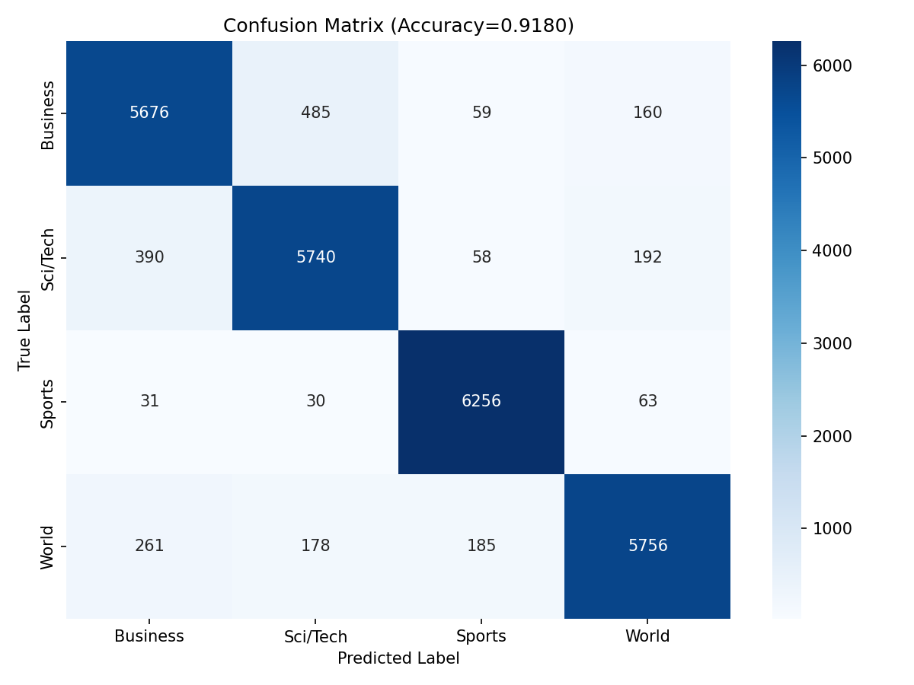

# Model Metrics

**Model**: LogisticRegression (C=1.0, multinomial, lbfgs)

**Features**: TF-IDF (max_features=50000, ngrams=1-2, sublinear_tf)

**Train/Test Split**: 80/20 stratified (train=102080, test=25520)

## Overall Metrics

| Metric | Value |
|--------|-------|
| Accuracy | 0.9180 |
| F1 (macro) | 0.9179 |
| F1 (weighted) | 0.9179 |

## Classification Report

```
              precision    recall  f1-score   support

    Business     0.8927    0.8897    0.8912      6380
    Sci/Tech     0.8923    0.8997    0.8960      6380
      Sports     0.9539    0.9806    0.9671      6380
       World     0.9327    0.9022    0.9172      6380

    accuracy                         0.9180     25520
   macro avg     0.9179    0.9180    0.9179     25520
weighted avg     0.9179    0.9180    0.9179     25520
```


